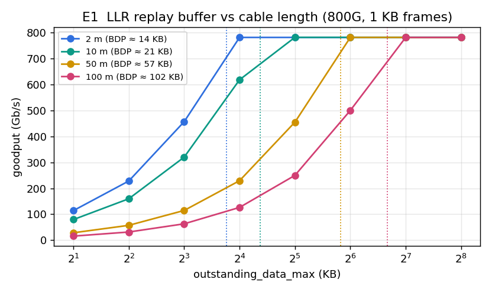
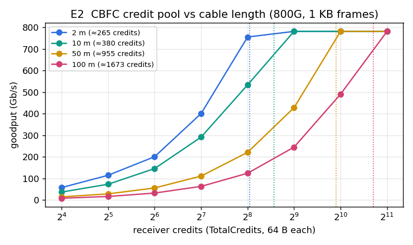
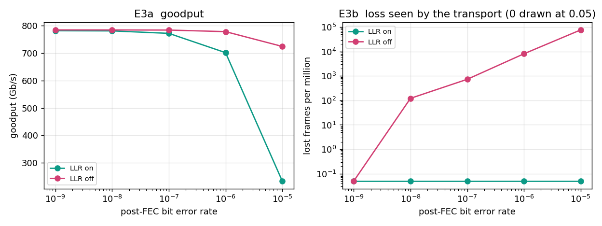

# M2: LLR and CBFC on one link

A discrete-event model of one full-duplex 800 Gb/s link with UEC 1.1 link-layer retry (LLR, §5.1) and credit-based flow control (CBFC, §5.2), used to answer the four M2 questions in [plan.md](../../plan.md) plus one more for M5. Everything here is regenerated by `tools/run_m2.py` (about 5 s); numbers are in [llr-cbfc-results.json](llr-cbfc-results.json).

## The model

`sim/` (pure Python, time in ns):

- **Link** (`sim/model.py`): two directions, each with rate, propagation delay (cable × ns/m + 50 ns MAC/PHY, from RM104 App A), a post-FEC bit error rate applied per frame and per CtlOS, and outage intervals. Frames cost size + 20 B (preamble + IPG); the LLR sequence number rides in the preamble, so it is free.
- **CtlOS**: one 8 B control block per slot every `ctlos_spacing` bytes of link time (2048 B ≈ 20 ns at 800G), stretching whatever frame is in flight. LLR ACK/NACK/INIT/INIT_ECHO and CBFC CF_Update share the slots.
- **LLR** (`sim/mac.py`), following Fig 5-3/5-4 and Tables 5-9…5-11: replay buffer bounded by `outstanding_data_max` and `outstanding_seq_max`; ADVANCE → REPLAY on NACK or replay-timer expiry; FLUSH after `replay_ct_max` replays without progress or when data is too old; INIT/INIT_ECHO re-synchronisation; receiver with `next_rx_seq`, one NACK then silence, silent duplicate filtering; 20-bit sequence arithmetic (tested across the wrap).
- **CBFC**: sender S_VC_CC (20-bit) and S_VC_CF (15-bit) cyclic counters and a per-VC credit limit; credits = ⌈(frame + PktOvhd) / CreditSize⌉; receiver input buffer drained at a set rate; CF_Update in CtlOS (CF_min / CF_max timers); CC_Update as a 64 B LLR-eligible, best-effort frame every `cc_interval_ns`, never during a replay; overflow of a lossless frame is counted.
- **§5.2.9 rules by construction**: CBFC sits above LLR. The sender counts credits once, when a frame is first sent; the receiver counts only frames LLR accepted in order; CC_Update is LLR-eligible, so it is discarded and replayed with the data. Three switches break one rule each for experiment 4.

Simplifications: one link (no switch yet), one VC, a backlogged source of 1 KB frames, no PCS-status timer, no "not in the first 256 B of a frame" rule for CtlOS, both ends start initialised. Error rates are deliberately far above real post-FEC rates (around 1e-12 and below) so that a few hundred microseconds of simulated time contain enough errors.

Checks: 16 tests in `tests/test_sim.py`, including one forced corruption → exactly one NACK and an in-order replay; a lost NACK covered by the replay timer; sequence wrap; outages with and without FLUSH; lost CF_Updates; CC_Update reclaiming exactly the credits of lost frames; the three broken rules.

## E1. How deep must the replay buffer be?

| Cable | Link round trip (est.) | BDP at 800G | Buffer for full rate (measured) |
|---|---|---|---|
| 2 m | ~139 ns | ~14 KB | 16 KB |
| 10 m | ~212 ns | ~21 KB | 32 KB (16 KB gives 618 Gb/s) |
| 50 m | ~580 ns | ~57 KB | 64 KB |
| 100 m | ~1040 ns | ~102 KB | 128 KB |

Below the bandwidth-delay product the link is window-limited: goodput ≈ buffer / round trip, a straight line on the plot. The round trip includes the wait for the next CtlOS slot, so the ACK spacing (2048 B) adds about 2 KB to every row.

**Takeaway.** `outstanding_data_max` must be at least the BDP or LLR itself throttles the link, and per Table 5-9 it *should* be about the BDP so that PFC still works (PAUSE can't stop a replay). The maximum supported cable length is therefore designed into the MAC's buffer: about 1 KB of replay buffer per metre at 800G. Scale-up's short links (≤ 10 m in RM104's budget) need only 16–32 KB.

## E2. What credit pool keeps the link at line rate?

| Cable | Credit loop estimate | Credits needed (64 B) | Measured knee |
|---|---|---|---|
| 2 m | ~170 ns | ~265 | 256 → 755 Gb/s, 512 → full |
| 10 m | ~243 ns | ~380 | 512 |
| 50 m | ~611 ns | ~955 | 1024 |
| 100 m | ~1071 ns | ~1673 | 2048 |

The credit loop is longer than the LLR loop: frame flight + waiting for a CtlOS slot + `CF_min_timer` + flight back. With too few credits the sender idles waiting for CF_Updates; like E1 the curve is a straight line until the pool covers the loop.

**Takeaway.** The receiver's per-port lossless buffer must cover the credit loop (about 17 KB at 2 m, 107 KB at 100 m at 800G). Unlike PFC, getting it wrong costs throughput, never frames: no configuration in E2 overflowed.

## E3. LLR on vs off: what reaches the transport?

| Post-FEC BER | LLR off: lost frames / million | LLR off: goodput | LLR on: lost | LLR on: goodput | LLR on: frames replayed per error | LLR on: p99 latency |
|---|---|---|---|---|---|---|
| 1e-9 | 0 (no errors in the run) | 784 | 0 | 781 | n/a | 85 ns |
| 1e-8 | 121 (few events: noisy) | 784 | 0 | 781 | 14.3 | 85 ns |
| 1e-7 | 727 | 784 | 0 | 772 | 14.9 | 231 ns |
| 1e-6 | 8054 | 778 | 0 | 701 | 13.5 | 252 ns |
| 1e-5 | 76380 | 724 | 0 | **234** | 8.0 | **6.2 µs** |

With LLR off every corrupted frame is a loss the transport must repair end to end (RODL Go-Back-N, or a dead PDC in SUE-lite). With LLR on nothing reaches the transport, at the cost of one link round trip of replay per error (~14 frames of 1 KB here).

At very high error rates Go-Back-N at the link collapses: at BER 1e-5 about 8% of 1 KB frames are corrupted, so a 14-frame replay itself is likely to contain an error, and goodput falls to 234 Gb/s while tail latency reaches microseconds. Real links are many orders of magnitude cleaner, so the practical lesson is about **bad links**, not normal ones: a degrading link has to be detected and taken out of service (link flap, FEC margin monitoring), because LLR will keep it "lossless" while making it very slow.

## E4. What does each LLR + CBFC rule protect?

Slow receiver (drain 400 Gb/s, 256 credits) so credits are the bottleneck, BER 2e-6 so replays happen, five seeds of 60 µs each:

| Variant | Overflow drops | Frames lost | "Serious error" (negative LostCredits) | Credits falsely reclaimed | Goodput |
|---|---|---|---|---|---|
| correct | 0 | 0 | 0 | 0 | 380.4 |
| rule 1 broken: sender counts replays again | 0 | 0 | 0 | 27840 | 372.4 |
| rule 2 broken: receiver counts frames LLR discards | 0 | 0 | 210 | 0 | 380.4 |
| rule 3 broken: CC_Update honoured in the discard window | **42** | **42** | 25 | 2480 | **36.8** |

- **Rule 1** (§5.2.9 rule 1): double-counted credits make the sender think the receiver is fuller than it is. It slows down until the next CC_Update "reclaims" the phantom credits. Wasteful, not dangerous.
- **Rule 2**: the receiver's consumed counter runs ahead of the sender's, so every CC_Update yields a negative LostCredits, which the spec says to report as a serious error. Throughput is unaffected here, but the counters can no longer detect real leaks.
- **Rule 3** is the dangerous one. A CC_Update that arrives while LLR is discarding frames says "I sent these credits' worth", the receiver sees them missing, declares them lost and returns them, and the sender reuses them while the same frames are being replayed into the buffer. The buffer **overflows on a lossless VC**. Worse, each overflowed frame was already counted as received, so its credits leak permanently: no CC_Update can recover them (sender and receiver counters agree), and goodput collapses to 37 Gb/s. That is why CC_Update must be LLR-eligible.

## E5. How long an outage can LLR absorb? (for M5)

`replay_timer` 1 µs, `replay_ct_max` 3, 16 KB replay buffer, link down at t = 10 µs:

| Outage | Recovered by | Frames lost | Credits reclaimed by CC_Update |
|---|---|---|---|
| 0.1 µs, 0.3 µs | one NACK | 0 | 0 |
| 1–4 µs | 1–3 replay-timer expiries | 0 | 0 |
| 6 µs, 10 µs | FLUSH + INIT | 10 | 160 (= 10 × 16) |

LLR absorbs outages up to about `replay_timer × (replay_ct_max + 1)`. Beyond that it gives up: FLUSH throws away the replay buffer (frames the receiver already had are counted as delivered, not lost) and CC_Update repairs the credit accounting. Those lost frames are now the transport's problem, and in SUE-lite they kill the PDC. A link that stays down needs something above the link: another port or plane. SUE-T 1.0 leaves that as future work, which is exactly what M5 compares against MRC and MetaRoCE.

## Answers to the plan's open questions

- **"LLR is optional in ESUN. What does SUE-T assume when LLR is off?"** E3: every corrupted frame becomes an end-to-end loss (8,000 per million at BER 1e-6 with 1 KB frames), recovered by RODL Go-Back-N over the whole path, or fatal in SUE-lite. SUE-T's "lossless network" requirement can only be met at realistic error rates with LLR, or with transport retransmission enabled.
- **CBFC with LLR**: correct only if the §5.2.9 rules hold; rule 3 is the one whose violation loses frames (E4).

## Next

- Add a switch (two links in series) and a second VC, so credit back-pressure and replays interact across hops (M3/M4 prerequisite).
- Generate CC_Update frames into a pcap for the M1b `packet-macctrl.c` work.
- Feed E5's outage behaviour into the M5 comparison.
