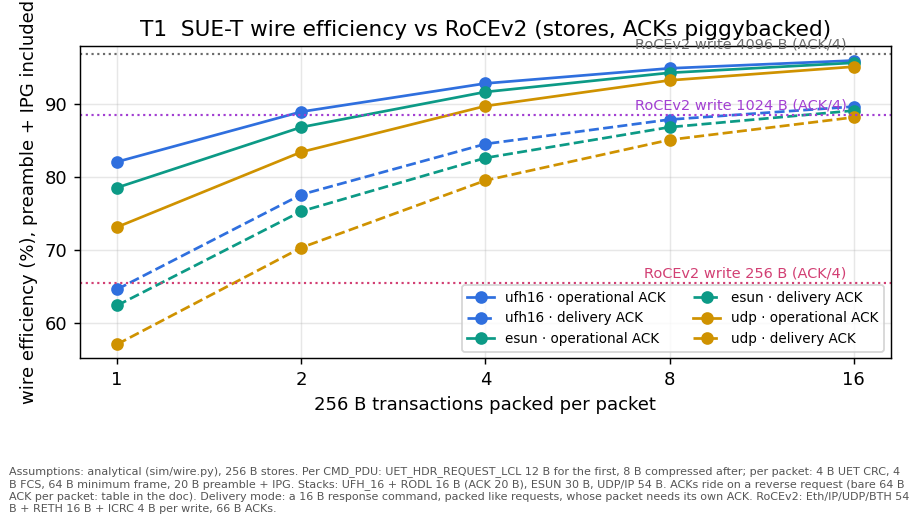
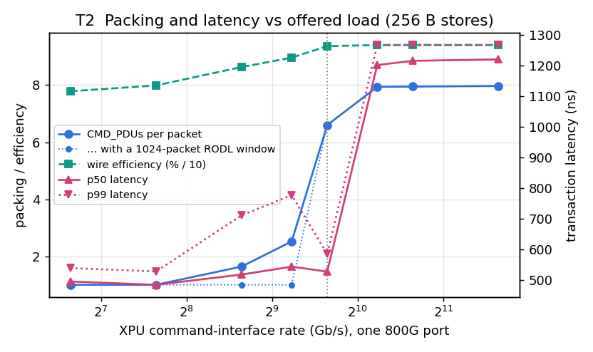
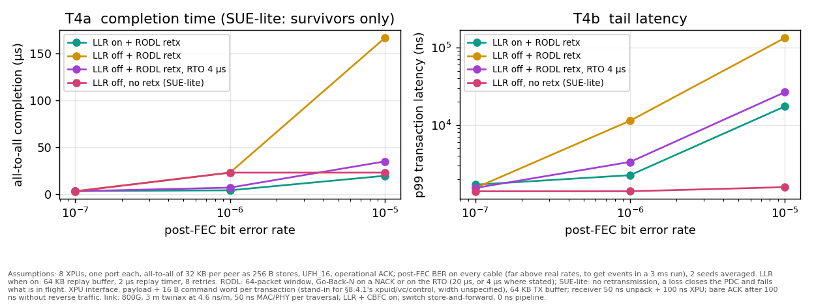
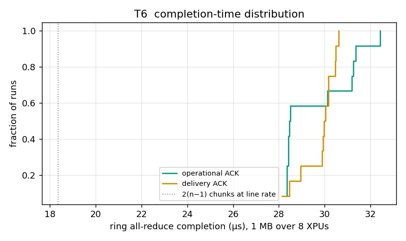

# M3: the SUE-T endpoint

A discrete-event model of a SUE-T instance (SUE-T Base 1.0.0 §6–§7) on the M2 link model, on a one-hop fabric of N XPUs. It answers the M3 questions in [plan.md](../../plan.md): what wire efficiency the header stack, the ACK mode and packing give against RoCEv2 (§7.2.3), what packing costs in latency, where the retry should live, whether per-group load balancing is safe, and what the completion-time tail of a collective looks like. Everything here is regenerated by `tools/run_m3.py` (about 20 s); numbers are in [suet-endpoint-results.json](suet-endpoint-results.json).

> **How to read this.** Each experiment starts with a *Predict* line. Write your one-line guess before reading the table. The [Decisions](#decisions-you-can-overturn) list at the end names the modelling choices the spec leaves open; each has an alternative, and `SUETCfg` makes most of them a one-word change.

## The model

`sim/suet.py` (endpoint), `sim/fabric.py` (N XPUs × P planes with a VOQ switch each), `sim/workloads.py` (all-to-all, ring all-reduce), `sim/wire.py` (byte accounting, checked against the real frames `sue/frame.py` builds):

- **XPU command interface** (§8.2): a pull interface at `xpu_gbps` (1.6 Tb/s by default, i.e. faster than one 800G port, as §7.3 anticipates) into a 64 KB transmit buffer. When the buffer is full the XPU is held back.
- **Queues and scheduler** (§7 steps 3–5, Figure 6): one queue per {dstXPU, TC}; round robin between TCs, arrival order within a TC; work conserving, so a lone transaction goes out alone and a queue that has accumulated gets packed, up to 16 CMD_PDUs, 2 KB of store payload or 2 KB of load response payload. Headers: UET_HDR_REQUEST_LCL 12 B for the first CMD_PDU, 8 B (ac=1) after it, payload padded to 4 B, 4 B UET CRC, 64 B minimum frame.
- **RODL** (§7.5, UEC §3.5.7.3): one PDC per {dstXPU, TC}, PSNs, a hold buffer of 64 packets, Go-Back-N on a NACK or a 20 µs timer; or no retransmission (SUE-lite), where a loss closes the PDC, fails everything in flight and the next packet re-establishes it with `syn`. The receiver NACKs a gap once and drops until the expected PSN arrives; duplicates are dropped and re-ACKed.
- **ACK carriage**: the reverse direction's ACK state rides in request headers of the same PDC (§7.1 note); when nothing goes that way within 100 ns a bare ACK packet (64 B) is sent on the response TC.
- **ACK modes** (§7.1): *Delivery*: ACK on acceptance; the XPU-level response is a 16 B command on the response TC (§7.1.2's "16-byte response command"), packed like any request, carrying the data for loads. *Operational*: the ACK waits until the XPU has processed every CMD_PDU in the packet (50 ns unpack + 100 ns XPU); stores need nothing else, loads get their data back as 4 B SES responses in an ACK packet.
- **Ports** (§6 step 6, §7.6): fixed per {dstXPU, TC} (hashed with the sender's id), or per packed group, where the first port with room takes the next group.
- **Fabric**: XPU i's port p is cabled to port i of switch p; every link is the M2 link with LLR and CBFC, one lossless VC per TC, 64 KB per VC at each end. The switch is store-and-forward with virtual output queueing and no pipeline latency yet.
- **Header stacks** (§8.3): UFH_16 + compressed RODL = 16 B (ACK 20 B); Ethernet + ESUN EH + RODL = 30 B; Ethernet + IPv4 + UDP + RODL = 54 B. RoCEv2 for comparison: Eth/IP/UDP/BTH (54 B) + RETH 16 B + ICRC 4 B for a write, 66 B ACKs.

Checks: 14 tests in `tests/test_suet.py` (packing bounded by the caps, a lost packet repaired by one NACK and a replay, SUE-lite closing the PDC, LLR hiding the same loss, lost ACKs covered by the timer, both planes used, per-group balancing reordering a PDC, the ring all-reduce finishing every step, backpressure through the switch without drops, tracing not changing anything) and 6 in `tests/test_wire.py` (the byte accounting equals real frames from `sue/frame.py`, including the §7.1.2 efficiency claims).

## T1. Wire efficiency: header stack × ACK mode × packing, against RoCEv2 (§7.2.3)

Analytical, from `sim/wire.py`. 256 B stores; efficiency = payload ÷ everything on the wire in both directions, preamble and IPG included. ACKs piggybacked on reverse traffic; in brackets, a bare ACK packet per request packet instead.

*Predict: how many 256 B stores must be packed over UFH_16 to beat a 1 KB RoCEv2 write? Does ESUN's extra 14 B matter?*

| Packed per packet | 1 | 2 | 4 | 8 | 16 |
|---|---|---|---|---|---|
| UFH_16, operational ACK | 82.1 (64.7) | 88.9 (77.6) | 92.8 (86.2) | 94.8 (91.3) | 95.9 (94.0) |
| UFH_16, delivery ACK | 64.7 (55.7) | 77.6 (70.7) | 84.5 (80.3) | 87.8 (85.5) | 89.6 (88.4) |
| ESUN, operational ACK | 78.5 (62.4) | 86.8 (76.0) | 91.6 (85.2) | 94.2 (90.7) | 95.6 (93.7) |
| ESUN, delivery ACK | 62.4 (54.0) | 75.3 (68.8) | 82.6 (78.5) | 86.8 (84.5) | 89.0 (87.8) |
| UDP/IP, operational ACK | 73.1 (59.0) | 83.4 (73.4) | 89.7 (83.5) | 93.2 (89.8) | 95.0 (93.2) |
| UDP/IP, delivery ACK | 57.1 (50.0) | 70.3 (64.7) | 79.5 (75.7) | 85.1 (82.9) | 88.1 (86.9) |

| RoCEv2 RC, one write per packet | 256 B | 1 KB | 4 KB |
|---|---|---|---|
| ACK per packet | 58.2 | 84.8 | 95.7 |
| ACK every 4 packets | 65.6 | 88.4 | 96.8 |

Same payload, same wire: a 1 KB transfer is four packed 256 B stores in SUE-T (92.8 %) against one RoCEv2 write (84.8–88.4 %); 4 KB is sixteen packed stores (95.9 %) against one write (95.7–96.8 %).

**Takeaway.** The spec's numbers come out of the byte count: over UFH_16 with two packed CMD_PDUs, operational ACKs give 92 % at frame level (89 % with preamble and IPG) and delivery ACKs with a 16 B response command fall below 80 % as soon as the response packet needs its own ACK (74.9 % frame level). Three things each buy about the same: packing 1→2, operational instead of delivery ACKs, and UFH_16 instead of UDP/IP (–38 B per packet). SUE-T's advantage over RoCEv2 is a small-transaction advantage: 25–30 points at 256 B, gone at 4 KB. ESUN costs 1–4 points against UFH_16 for keeping real MAC addresses.

## T2. Packing is opportunistic: what the load decides (§7.2.3, §7.3)

Two XPUs, one way: XPU A writes 1 MB to XPU B as 4096 stores of 256 B, operational ACKs over UFH_16, one 800G port. The knob is how fast A's command interface hands stores to SUE-T, swept from 100 Gb/s to 3.2 Tb/s; below 800 G the XPU is the bottleneck, above it the port is. The scheduler never waits to pack: a store that finds the port free goes out alone, and a packet carries more only if stores piled up while the port was busy or blocked. *Latency* is from the XPU handing over a store to its ACK arriving, so time spent in the 64 KB transmit buffer counts. *Packets* counts both directions; the receiver holds a bare ACK for 100 ns and ACKs are cumulative, so one ACK covers every packet that arrived meanwhile.

*Predict: at what interface rate does the average packet carry more than one transaction, and what happens to latency when the XPU outruns the port?*

| XPU interface | CMD_PDUs / packet | Wire efficiency | Goodput (Gb/s) | p50 latency | p99 latency | Packets | CMD_PDUs / packet, window 1024 | Efficiency, window 1024 | p99, window 1024 |
|---|---|---|---|---|---|---|---|---|---|
| 100 G | 1.00 | 77.8 % | 94 | 495 ns | 539 ns | 4916 | 1.00 | 77.8 % | 539 ns |
| 200 G | 1.00 | 79.9 % | 186 | 484 ns | 528 ns | 4506 | 1.00 | 79.9 % | 528 ns |
| 400 G | 1.64 | 86.3 % | 367 | 518 ns | 711 ns | 2657 | 1.00 | 80.9 % | 522 ns |
| 600 G | 2.52 | 89.6 % | 547 | 543 ns | 777 ns | 1747 | 1.00 | 81.3 % | 520 ns |
| 800 G | 6.60 | 93.7 % | 718 | 527 ns | 585 ns | 720 | 6.60 | 93.7 % | 585 ns |
| 1.2 T | 7.94 | 94.1 % | 724 | 1201 ns | 1266 ns | 619 | 7.94 | 94.1 % | 1266 ns |
| 1.6 T | 7.95 | 94.1 % | 724 | 1215 ns | 1266 ns | 618 | 7.95 | 94.1 % | 1266 ns |
| 3.2 T | 7.97 | 94.1 % | 724 | 1219 ns | 1266 ns | 617 | 7.97 | 94.1 % | 1266 ns |

Three regimes:

- **Below half the port rate (100–200 G)**: a store arrives every 11–22 ns and a single-store packet takes 3.1 ns to send, so the port is idle most of the time and every store travels alone. Efficiency is T1's one-packed figure, 78–80 % (between the bare-ACK 65 % and the piggybacked 82 %, because one ACK covers about five packets). Goodput is the interface rate minus the 16 B command word per store. Latency is the floor: four hops of about 65 ns, 150 ns at the receiver, up to 100 ns waiting for the ACK to go out.
- **Between half and the full port rate (400–600 G)**: the port is still faster than the XPU, so nothing should queue, and with a large RODL window nothing does (1.00 CMD_PDUs per packet, 81 %). The packing in the main columns is an artefact of the **64-packet window**: at 400 G the PDC puts 64 single-store packets on the wire in 350 ns, less than the 0.5 µs it takes the first ACK to come back, and stalls. The stores that arrive during the stall go out as full 2 KB packets when the window reopens, which is why the histogram is bimodal (2219 packets of one store, 193 of eight, almost nothing in between), and why p99 latency rises 200 ns while p50 barely moves. 64 packets × 256 B is 16 KB, below the bandwidth-delay product of a 400 G stream over this round trip (25 KB); a window counted in packets is a window counted in bytes only for large packets.
- **At and above the port rate (800 G and up)**: the port is the bottleneck, so a queue forms whatever the window. At exactly 800 G the packing settles at 6.6 per packet, which is where the port's per-store cost (a 7-store packet is 1896 B on the wire, 2.71 ns per store) equals the arrival interval (2.72 ns); the queue stays short and latency stays at the floor. Beyond that the queue grows until the 64 KB transmit buffer is full and the XPU is held back. Every store then waits for 64 KB ahead of it to drain through the port (about 0.7 µs), so p50 latency goes from 0.5 to 1.2 µs. Packing is at the 2 KB cap and the forward wire is 94 % payload.

**Takeaway.** Packing is a side-effect of a queue, and the queue has two causes: a port slower than the XPU (the one §7.2.3 and §7.3 talk about), and a RODL window that closes while the port is idle (which the spec does not mention, and which with 256 B packets happens at half the port rate). The first buys 94 % wire efficiency for 0.7 µs of transmit-buffer latency; §7.2.3's "more buffering increases the opportunity to pack" is exactly that trade, and the lever is `tx_buf`. The second buys efficiency with tail latency: 86 % and a 711 ns p99 at 400 G against 81 % and 522 ns with a window that never closes. An implementation that sizes the hold buffer in packets should size it for its smallest packet, or expect the oscillation seen here.

## T3. ACK mode and header stack under all-to-all

Eight XPUs, 32 KB to each peer as 256 B transactions, one port each; ACK state rides on reverse requests when it can.

*Predict: does delivery mode hurt stores or loads more, and by how much?*

| Op | Stack | ACK mode | Wire efficiency | Overhead per payload byte | Completion | p50 latency | p99 latency | Packets (bare ACKs) |
|---|---|---|---|---|---|---|---|---|
| store | UFH_16 | operational | 93.1 % | 0.075 | 3.00 µs | 1191 ns | 1390 ns | 1376 (376) |
| store | UFH_16 | delivery | 84.4 % | 0.185 | 3.17 µs | 1258 ns | 1449 ns | 2880 (824) |
| store | ESUN | operational | 92.4 % | 0.082 | 3.02 µs | 1204 ns | 1399 ns | 1376 (384) |
| store | ESUN | delivery | 83.3 % | 0.200 | 3.20 µs | 1300 ns | 1525 ns | 2896 (848) |
| store | UDP/IP | operational | 91.0 % | 0.099 | 3.06 µs | 1216 ns | 1399 ns | 1464 (480) |
| store | UDP/IP | delivery | 81.5 % | 0.227 | 3.26 µs | 1271 ns | 1459 ns | 2904 (888) |
| load | UFH_16 | operational | 91.2 % | 0.096 | 2.85 µs | 1617 ns | 2761 ns | 1872 (936) |
| load | UFH_16 | delivery | 86.1 % | 0.161 | 3.03 µs | 1748 ns | 2946 ns | 2296 (440) |
| load | ESUN | operational | 90.2 % | 0.108 | 2.86 µs | 1623 ns | 2772 ns | 1872 (936) |
| load | ESUN | delivery | 84.8 % | 0.179 | 3.06 µs | 1762 ns | 2973 ns | 2400 (544) |
| load | UDP/IP | operational | 88.3 % | 0.132 | 2.89 µs | 1646 ns | 2799 ns | 1856 (928) |
| load | UDP/IP | delivery | 83.1 % | 0.204 | 3.09 µs | 1779 ns | 3004 ns | 2400 (552) |

**Takeaway.** Operational ACKs halve the packet count for stores (every response command packet disappears) and cut the overhead per payload byte from 0.19 to 0.08. For loads the data has to come back either way, so the gap is smaller (0.16 → 0.10). Even with traffic in both directions a quarter of the packets are bare ACKs: a PDC sees a reverse packet only every few hundred nanoseconds, longer than the 100 ns a receiver waits before sending one. The latencies here are dominated by the 64 KB transmit buffer (T2), not by the fabric.

## T4. Where the retry lives: LLR, RODL Go-Back-N, or nowhere

Eight XPUs, all-to-all stores, bit errors on every cable, two seeds. Post-FEC error rates this high only describe a degrading link; the point is what each layer does with a loss.

*Predict: which layer gives the lowest tail latency at 1e-6, and what does SUE-lite do at 1e-7?*

| Variant | BER | Done / failed | Completion | p99 latency | Max latency | Efficiency | RODL NACK / retx / timeouts | PDCs closed | LLR replays |
|---|---|---|---|---|---|---|---|---|---|
| LLR on + RODL retx | 1e-7 | 14336 / 0 | 3.33 µs | 1.69 µs | 1.89 µs | 93.0 % | 0 / 0 / 0 | 0 | 68 |
| | 1e-6 | 14336 / 0 | 4.08 µs | 2.25 µs | 2.75 µs | 92.8 % | 0 / 0 / 0 | 0 | 519 |
| | 1e-5 | 14336 / 0 | 19.5 µs | 17.4 µs | 19.5 µs | 92.4 % | 0 / 0 / 0 | 0 | 8780 |
| LLR off + RODL retx (RTO 20 µs) | 1e-7 | 14336 / 0 | 3.13 µs | 1.53 µs | 2.05 µs | 92.0 % | 5 / 21 / 0 | 0 | 0 |
| | 1e-6 | 14336 / 0 | 22.9 µs | 11.3 µs | 21.9 µs | 84.7 % | 46 / 188 / 2 | 0 | 0 |
| | 1e-5 | 14336 / 0 | 166 µs | 133 µs | 184 µs | 26.4 % | 509 / 4864 / 264 | 0 | 0 |
| LLR off + RODL retx (RTO 4 µs) | 1e-7 | 14336 / 0 | 3.13 µs | 1.53 µs | 2.05 µs | 92.0 % | 5 / 21 / 0 | 0 | 0 |
| | 1e-6 | 14336 / 0 | 6.94 µs | 3.33 µs | 5.90 µs | 84.7 % | 46 / 188 / 2 | 0 | 0 |
| | 1e-5 | 14336 / 0 | 34.8 µs | 26.5 µs | 36.4 µs | 27.0 % | 509 / 4746 / 253 | 0 | 0 |
| LLR off, no retx (SUE-lite) | 1e-7 | 14176 / 160 | 3.00 µs | 1.39 µs | 1.40 µs | 93.1 % | 5 / – / 0 | 5 | 0 |
| | 1e-6 | 12586 / 1750 | 22.9 µs | 1.39 µs | 1.54 µs | 93.2 % | 49 / – / 6 | 55 | 0 |
| | 1e-5 | 5023 / 9313 | 22.9 µs | 1.57 µs | 1.75 µs | 93.7 % | 199 / – / 50 | 249 | 0 |

(SUE-lite's "completion" is when the last transaction either completed or was failed; its latencies are those of the survivors.)

**Takeaway.**
- **LLR repairs a loss in one link round trip and the transport never hears of it**: at 1e-6 the whole all-to-all costs 1 µs more than the clean run, and p99 stays near 2 µs. With LLR off, the same errors cost RODL a path round trip of Go-Back-N each (188 packets resent for 46 losses) and, worse, every loss not followed by another packet on that PDC waits for the timer: 22.9 µs with a 20 µs RTO, 6.9 µs with 4 µs. Go-Back-N's tail is the timer, not the resend.
- **The two timers must be ordered.** The first run of this experiment used a 4 µs RTO with LLR on and produced 335 RODL timeouts and 1615 transport retransmissions at 1e-5, all of them for packets LLR was still replaying (8 retries × 2 µs replay timer). A transport retransmission timer below the link's worst-case recovery time makes the two layers fight. Rule: RTO > replay_timer × (replay_ct_max + 1); the model's default is now 20 µs, ten times the < 2 µs RTT target.
- **SUE-lite** keeps the clean latency for the transactions that survive and simply loses the rest: 160 of 14 336 at 1e-7, two thirds at 1e-5. It is only viable on a link that is lossless in practice, which at real post-FEC rates (1e-12 and below) a link with LLR is. Without LLR, a bit error is a dead PDC (M2 E3 said the same from the link's side).

## T5. Load balancing across two ports (§7.6 vs §6 step 6)

Eight XPUs with two ports each, two switch planes, all-to-all stores. *Fixed*: the port is a function of {dstXPU, TC}. *Per group*: each packed group goes to the first port with room.

*Predict: is per-group balancing safe when both planes are identical? When one plane's cables are 20 m instead of 3 m?*

| Planes | Port choice | Completion | Efficiency | RODL NACKs | Retransmitted | p99 latency | CMD_PDUs / packet | Packets |
|---|---|---|---|---|---|---|---|---|
| both 3 m | fixed per PDC | 1.95 µs | 87.9 % | 0 | 0 | 751 ns | 1.9 | 3928 |
| both 3 m | per packed group | 1.77 µs | 91.3 % | 0 | 0 | 598 ns | 3.4 | 2304 |
| plane 1 at 20 m | fixed per PDC | 2.11 µs | 87.9 % | 0 | 0 | 1036 ns | 1.9 | 3952 |
| plane 1 at 20 m | per packed group | **5.37 µs** | **25.8 %** | **680** | **4424** | 3585 ns | 4.6 | 7136 |

**Takeaway.** With identical planes, per-group balancing is both faster and better packed (the free port pulls whatever is queued), and nothing reorders because both paths have the same delay. Give one plane 78 ns more latency and consecutive packets of one PDC arrive out of order; RODL treats every reorder as a loss, NACKs and goes back N: 680 NACKs, 4424 resent packets, efficiency a quarter of the fixed mapping's. This is delta-table open item 8 measured: §7.6's per-group balancing is only safe when every port of an instance reaches the same switch with the same delay, or when the balancing is restricted to whole PDCs. A fixed mapping must include the sender's id in the hash (first version of this model did not, and every XPU reached a given destination through the same plane, leaving the other idle).

## T6. Ring all-reduce completion time

Eight XPUs, 1 MB, ring algorithm: seven reduce-scatter steps of 128 KB stores to the next XPU, seven all-gather steps of 128 KB loads from the previous one, each step waiting for its data and its ACKs. Twelve runs with random start offsets up to 300 ns.

*Predict: how close to 2(n−1) chunk times at line rate (18.4 µs) does it get?*

| ACK mode | Completion p50 | min | max | Transaction p99 |
|---|---|---|---|---|
| operational | 28.5 µs | 28.3 µs | 32.4 µs | 2.10 µs |
| delivery | 30.0 µs | 28.1 µs | 30.6 µs | 1.94 µs |

**Takeaway.** 64 % of line rate. Each of the 14 steps moves its 128 KB in 1.3 µs and then pays about 0.7 µs of barrier: the last transaction of the step has to drain the transmit buffer, cross the fabric, be executed and acknowledged before the next step's first transaction can be issued, and the ring makes every XPU wait for its neighbour's step. The two ACK modes differ by less than the run-to-run spread: at this size the fabric is not the bottleneck, the step synchronisation is. Pipelining (several chunks per step in flight) would hide it; that is the XPU's collective library, not SUE-T. The tail (max 32.4 µs) comes from unlucky start offsets stacking up around the ring.

## Answers to the plan's M3 questions

- **Wire efficiency vs RoCEv2 at the same payload sizes (§7.2.3)**: T1. At 256 B, SUE-T over UFH_16 with operational ACKs and two packed CMD_PDUs is at 89–92 % against RoCEv2's 58–66 %; at 4 KB both are at 96 %. The efficiency comes from three independent sources of about equal size: packing, operational ACKs and the 16 B header stack.
- **Goodput efficiency and completion-time tail of all-to-all and all-reduce**: T3 and T6. Overhead per payload byte 0.075 (operational) to 0.185 (delivery) in all-to-all; the all-reduce reaches 64 % of line rate, limited by per-step synchronisation.
- **Both ACK modes**: implemented; operational is 9 points better for stores and 5 for loads (T3), at the price of per-command state at the source.
- **Load balancing across ports (§7.6)**: T5. Per-group balancing is safe only across equal-delay planes; otherwise it fights RODL's ordering.

## Decisions you can overturn

Each one is a choice the spec leaves open. Change it and rerun `tools/run_m3.py`; `tests/test_suet.py` tells you what else moved.

| # | Choice | What we do | The alternative | Where |
|---|---|---|---|---|
| M3-1 | PDC granularity | One bidirectional PDC per {dstXPU, TC}; ACK state rides on reverse requests of that PDC | One PDC per XPU pair carrying all TCs (ACKs could then ride on response-TC packets too) | `Endpoint.pdc`, `on_frame` |
| M3-2 | Bare ACK timing | After 100 ns without a reverse packet; a NACK immediately | Coalesce longer (fewer packets, slower hold-buffer release), or per-N-packets | `SUETCfg.ack_hold_ns` |
| M3-3 | Delivery-mode response | A 16 B command on the response TC (§7.1.2's number), packed like requests | 12 B (plain SES header) or 8 B (compressed), SUE-T §7.2.1's "8 bytes of response state" | `SUETCfg.resp_cmd` |
| M3-4 | Operational-mode load data | SES responses (4 B + data) in an ACK packet, 2 KB max; a duplicate request is re-ACKed *without* data | Keep response state per PSN at the target and resend data on a duplicate (UEC's ACK retention) | `Endpoint._next_ack`, `on_frame` |
| M3-5 | Scheduler | Round robin between TCs, arrival order inside; pack what is there | Weighted round robin, or priority to the response TC | `Endpoint._next_req` |
| M3-6 | Port mapping | `(src + dst + tc) mod ports`, or per packed group | Any hash; or balance across PDCs only (reading (a) of open item 8) | `Endpoint.port_of` |
| M3-7 | RODL timer | Fixed 20 µs | Adaptive (RTT-based); the spec does not say | `SUETCfg.rto_ns` |
| M3-8 | Switch | VOQ, store-and-forward, 0 ns pipeline, 64 KB per VC per ingress port | Add RM104's 250 ns pipeline budget; cut-through; shared buffer | `Fabric(pipeline_ns=…)` |
| M3-9 | XPU side | 1.6 T command interface, 64 KB TX buffer, 50 ns unpack, 100 ns to execute a command | Anything; the TX buffer is the packing-vs-latency lever (T2) | `SUETCfg.xpu_gbps`, `tx_buf`, `rx_ns`, `xpu_ns` |
| M3-10 | Not modelled | Encryption, CRC time, DMA out of HBM, multiple SUE-T instances per XPU, the control channel (§7.7), jobid checks | — | — |
| M3-11 | RODL window | 64 packets per PDC, whatever their size (the hold buffer of §7.2.2 counted in packets) | Count it in bytes, or more packets; T2 shows what 64 does to a stream of small packets at half the port rate | `SUETCfg.window` |

## Next

- Feed T4 and T5 into M5's three-way comparison: LLR + RODL against MRC's fast NACK across planes and MetaRoCE's RTO-driven pair moves, under the same plane failure.
- Switch pipeline latency (M3-8) and 4 TCs (high/low priority requests) once the netns emulator (M4) needs them.
- The packet viewer shows the two-hop link layer; the endpoint (queues, packing, PSNs, ACK modes) is the next thing to draw: see [docs/viz/ROADMAP.md](../viz/ROADMAP.md).
