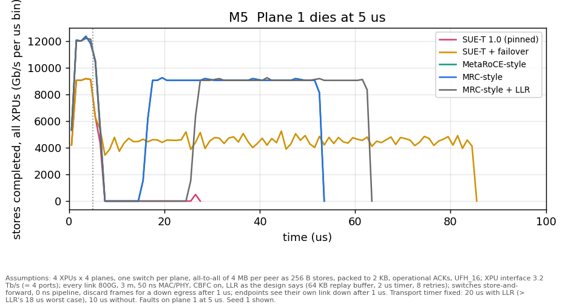
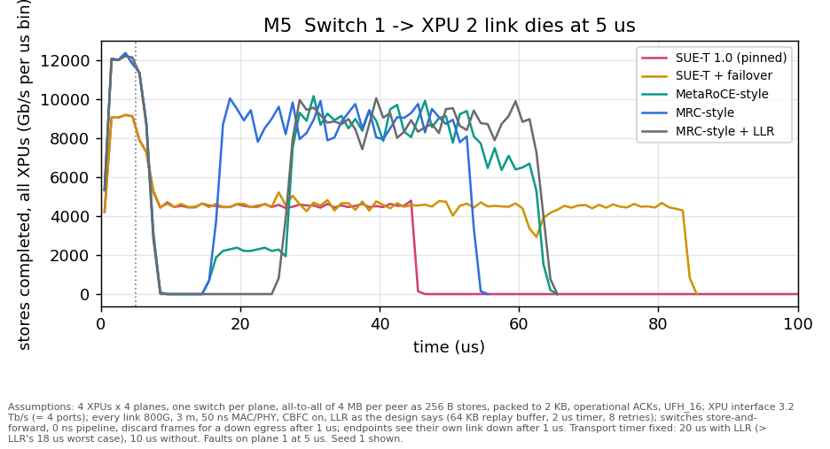
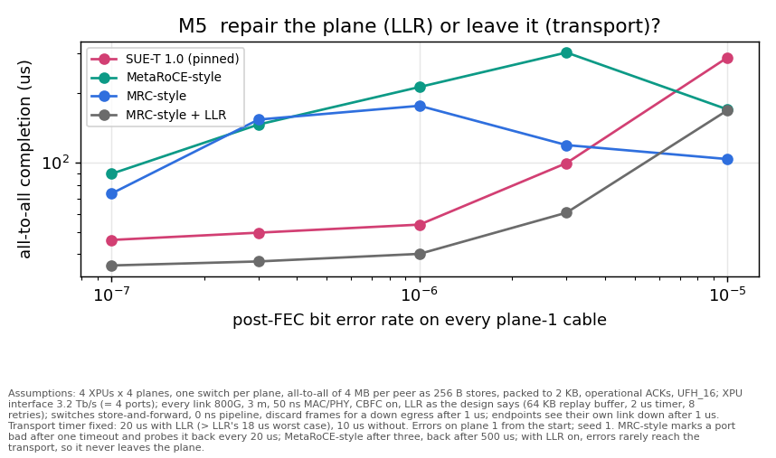
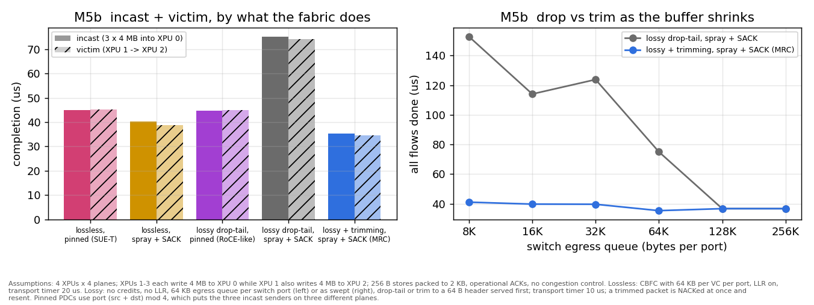

# Where should the retry live?

The question this project set out to answer: in a multi-plane scale-up fabric, should a lost or stuck packet be recovered by the **link** (UEC LLR, hop by hop, with lossless CBFC underneath) or **end to end** by the transport, as MRC and MetaRoCE do in scale-out? And does the answer change when a whole plane, rather than one packet, goes wrong?

**Short answer.** Both, for different faults, and the transport must be able to leave a path.

- **Random bit errors and short outages belong to the link.** LLR repairs them in a link round trip, below the transport's notice, with no timer: every design with LLR finished the bit-error run with zero transport retransmissions, and MRC-style spraying over LLR links was 4x faster than the same transport without LLR (40 µs against 171 µs).
- **Anything that persists belongs to a transport that can change path.** A dead plane, a dead remote link, a plane that is merely slow, or one whose error rate keeps climbing: LLR cannot fix any of them, and a transport pinned to one port (SUE-T 1.0 as specified) cannot leave. Spreading every connection over all planes recovered every fault within one transport timeout and never lost a transaction.
- **The two interact through one number, the transport timer.** With LLR on, the transport timer must exceed LLR's worst-case recovery (2 µs × 9 = 18 µs, M3 T4), so every fault LLR cannot fix costs at least 20 µs before the transport reacts. Without LLR the timer can be 10 µs, but every bit error then costs a timeout.
- **There is a crossover.** LLR hides errors from the transport, so with LLR on the transport never leaves a degrading plane. Up to a post-FEC bit error rate of about 3e-6 on one plane, repairing is better; at 1e-5, abandoning the plane is (MRC-style without LLR: 104 µs; with LLR: 169 µs). The emulator, running at 1e-5, shows the same order.
- **A lossy fabric needs trimming for the same reason the links need LLR.** Without it every congestion drop costs a transport timeout (75 µs for an incast that trimming finishes in 35 µs), and drop-tail needs 128 KB of buffer per switch port to stop dropping; with trimming the completion barely moves between 8 KB and 256 KB.

Everything below is regenerated by `tools/run_m5.py` (simulator, about ten minutes) and `tools/run_m4.py run --planes` (emulator, in the VM). Numbers are in [planes-results.json](experiments/planes-results.json), [ber-sweep-results.json](experiments/ber-sweep-results.json), [congestion-results.json](experiments/congestion-results.json) and [emulator-planes-results.json](experiments/emulator-planes-results.json).

## The setup

`sim/planes.py` on the M3 fabric (`sim/fabric.py`): four XPUs, four ports each, one switch per plane (XPU i's port p goes to port i of switch p), every link the M2 link model (800G, 3 m, 50 ns MAC/PHY per traversal, CBFC on). Each XPU writes 4 MB to every other XPU as 256 B stores, packed up to 2 KB per packet, operational ACKs, UFH_16; the XPU interface runs at 3.2 Tb/s, so all four ports can be busy. Faults hit plane 1 at 5 µs. Three seeds (only the bit-error scenario depends on the seed; the others are deterministic).

The five designs are configurations of one endpoint (`sim/suet.py`), so every difference in the results comes from where and how retries happen, not from different code:

| Design | Path | Delivery | LLR | Transport timer | Leaves a path when | Comes back |
|---|---|---|---|---|---|---|
| **SUE-T 1.0** | PDC pinned to port (id + dst + tc) mod 4 (§6 step 6) | in order (RODL), Go-Back-N | on | 20 µs | never; after 8 timeouts the PDC is declared dead and its transactions fail | — |
| **SUE-T + failover** | PDC on one port, moves | in order (RODL), Go-Back-N | on | 20 µs | its NIC sees its link down (1 µs), or 1 timeout; goes to the port with the fewest PDCs and resends what was in flight | never (moved PDCs stay) |
| **MetaRoCE-style** | every packet on any usable port | out of order, SACK, selective resend | off | 10 µs | 3 timeouts on that port, or own link down | after a long timer (500 µs) |
| **MRC-style** | every packet on any usable port | out of order, SACK, selective resend | off | 10 µs | 1 timeout on that port, or own link down | when a probe (every 20 µs) is answered |
| **MRC-style + LLR** | as MRC | as MRC | on | 20 µs | as MRC | as MRC |

Every design limits a PDC to 64 packets of PSN span in flight, counted from the oldest unacknowledged packet: with SACK, a lost packet holds that window until it is resent, as in UEC.

SUE-T 1.0 has no failover: §7.5 says "a connection can be moved to a different port. This concept is left as future work". The SUE-T + failover column is therefore our design of that future work. The MRC and MetaRoCE rules are ported from the models in [metaroce-simulator](https://github.com/ravindra123987/metaroce-simulator) (`sim/mrc/endpoint.py`, `sim/metaroce/config.py`), which follow the MRC + SRv6 paper and MetaRoCE spec 1.0; the scale-out parameters (4 KB MTU, 100 µs minimum RTO) are replaced by scale-up ones, and congestion control is left out (a single-hop fabric, as SUE-T §7.5 assumes).

Two more things every design shares: an endpoint sees its own link down 1 µs after it fails (PCS link fault), and a switch discards frames for an egress port whose link has been down for 1 µs.

## The faults

*Predict, before reading the table: which design never finishes when plane 1 dies? Which one is fastest when the plane comes back after 10 µs? Is a dead remote link (which no sender can see) worse or better than a dead plane?*

| Scenario | Fault |
|---|---|
| clean | none |
| plane-kill | every cable of plane 1 dies at 5 µs and stays down |
| plane-flap | plane 1 down from 5 to 15 µs |
| remote-link | only the cable from switch 1 to XPU 2 dies at 5 µs: no sender's own link fails |
| plane-ber | post-FEC bit error rate 1e-6 on every plane-1 cable (a degrading plane) |
| plane-credits | plane 1's switch has 4 KB of ingress buffer per port instead of 64 KB: a plane that is up but slow |

## Results

Completion of the whole all-to-all and the worst transaction latency, both in µs ("—" = did not finish in 600 µs):

| Scenario | SUE-T 1.0 | SUE-T + failover | MetaRoCE-style | MRC-style | MRC-style + LLR |
|---|---|---|---|---|---|
| clean | 45.0 / 0.8 | 45.0 / 0.8 | 34.0 / 0.6 | 34.0 / 0.6 | 34.0 / 0.6 |
| plane-kill | **—** (1 520 failed, 171 376 stuck) | 84.8 / 3.7 | 52.9 / 11.0 | 52.9 / 11.0 | 62.9 / 21.1 |
| plane-flap | 55.5 / 11.6 | 84.7 / 3.8 | **43.8** / 11.0 | 48.6 / 11.0 | 44.5 / 11.7 |
| remote-link | **—** (11 648 failed, 62 528 stuck) | 84.6 / 24.4 | 64.3 / 21.5 | **54.2** / 11.2 | 64.6 / 21.4 |
| plane-ber | 57.4 / 4.3 | 57.0 / 5.0 | 218.9 / 20.8 | 171.2 / 11.8 | **40.4 / 4.0** |
| plane-credits | 335.7 / 6.1 | 335.7 / 6.1 | 43.5 / 0.9 | 43.5 / 0.9 | **43.4 / 0.9** |

What each layer did (sums over the run, seed means):

| Scenario | Design | Transport timeouts | Packets resent end to end | Plane marked bad / PDC moved | LLR frames replayed | LLR FLUSH | Switch discards |
|---|---|---|---|---|---|---|---|
| plane-kill | SUE-T 1.0 | 34 | 18 | — | 1 360 | 8 | 0 |
| | SUE-T + failover | 0 | 166 | 4 moves | 1 360 | 8 | 0 |
| | MRC-style | 36 | 128 | 12 bad | 0 | 0 | 0 |
| | MRC-style + LLR | 36 | 128 | 12 bad | 1 504 | 8 | 0 |
| plane-flap | SUE-T 1.0 | 0 | 0 | — | 826 | 0 | 0 |
| | MetaRoCE-style | 36 | 124 | 8 bad | 0 | 0 | 0 |
| | MRC-style | 36 | 124 | 12 bad, 12 restored | 0 | 0 | 0 |
| | MRC-style + LLR | **0** | **0** | — | 888 | 0 | 0 |
| remote-link | SUE-T 1.0 | 37 | 448 | — (23 PDCs declared dead) | 524 | 2 | 1 890 |
| | SUE-T + failover | 2 | 85 | 2 moves | 524 | 2 | 34 |
| | MRC-style | 12 | 51 | 4 bad | 0 | 0 | 25 |
| | MRC-style + LLR | 11 | 52 | 4 bad | 540 | 2 | 26 |
| plane-ber | SUE-T 1.0 | 0 | 0 | — | 2 190 | 0 | 0 |
| | MetaRoCE-style | 185 | 189 | 1 bad | 0 | 0 | 0 |
| | MRC-style | 87 | 94 | 48 bad, 45 restored | 0 | 0 | 0 |
| | MRC-style + LLR | **0** | **0** | — | 1 879 | 0 | 0 |

*Assumptions (also printed on the figure): as in [The setup](#the-setup); seed 1; goodput is stores completed per 1 µs bin over all four XPUs. The MetaRoCE-style line lies exactly under the MRC-style line.*

*Assumptions: as above. Only one cable fails; no sender's own link goes down, so only timeouts reveal it.*

[Plane 1 down from 5 to 15 µs](experiments/img/m5-plane-flap.png) is the third figure.

## What the runs say

**1. SUE-T 1.0 cannot survive a dead plane, and one dead PDC stalls the whole XPU.** When plane 1 dies, every PDC pinned to it keeps retransmitting into a link that will never come back; after eight timeouts (160 µs) the PDC is declared dead, its transactions fail, the next packet re-establishes it with `syn` on the same pinned port, and the cycle repeats. Worse, the plane-kill and remote-link figures show throughput collapsing for *every* destination, not only for the unreachable ones: the XPU's transmit buffer is shared, it fills with stores for the dead PDCs, and the XPU can no longer hand over stores for anyone. LLR does its job (1 360 frames replayed, then FLUSH after 8 replays); there is just nothing it can do about a cable that is gone. This is the strongest argument for treating SUE-T §7.5's "future work" as required.

**2. Failover saves SUE-T, but pinning costs it.** With failover the PDC leaves the dead port within 1 µs of the NIC seeing it and resends what was in flight, so nothing fails and the worst transaction takes 3.7 µs, the best tail of any design. But it finishes in 85 µs against 53 µs for the spray designs, for two reasons. Before any fault, pinning one PDC per {destination, TC} leaves a port idle (four XPUs have three peers each, so 45 µs clean against 34 µs). After the move, the senders choose new ports knowing only their own load, so two senders can land on the same plane towards the same receiver and share its downlink: the moved PDCs run at half rate to the end (choosing the target at random instead changes little: 85.6 µs). And a moved PDC never returns, so the 10 µs flap costs as much as a permanent failure (84.7 µs). MetaRoCE's real implementation has the same property (metaroce-simulator findings #7: a moved flow does not go back).

**3. Spraying makes recovery cheap, and out-of-order delivery is what allows it.** The spray designs lose only the packets that were in flight on the failed plane; they hold their PDC's window until one timeout finds them (10 µs without LLR, 20 µs with it), then they are resent on another plane, while the other three planes never stopped. The plane-credits run shows the other half of the argument: a plane that is up but slow (4 KB of switch buffer) holds pinned SUE-T to its pace for 336 µs, while the spray designs take packets on whichever port has room and finish in 43.5 µs. With in-order RODL, the same spraying over planes of unequal delay turns every reorder into a NACK and a Go-Back-N (M3 T5; `tests/test_planes.py` repeats it).

**4. LLR is the better tool for bit errors and short outages; the transport is the better tool for everything else.**
- plane-ber: with LLR, the 1e-6 errors on plane 1 never reach the transport (0 timeouts, 0 resends; MRC-style + LLR finishes in 40.4 µs with a 4.0 µs worst latency). Without LLR every corrupted packet holds its PDC's window for a 10 µs timeout: MRC-style takes 171 µs (it marks plane 1 bad 48 times and probes it back 45 times), MetaRoCE-style 219 µs.
- plane-flap: a 10 µs outage is shorter than LLR's give-up time (18 µs), so LLR holds the frames and replays them when the plane returns; the transport never times out (MRC-style + LLR: 0 timeouts, 44.5 µs). Without LLR the same flap costs a timeout and a bad mark (MRC-style: 48.6 µs).
- plane-kill and remote-link: LLR can only give up (FLUSH), and its presence forces the transport timer to 20 µs, so MRC-style + LLR reacts 10 µs later than MRC-style (worst latency 21.1 against 11.0 µs on plane-kill; completion 64.6 against 54.2 µs on remote-link).

**5. Repair or leave: the bit error rate decides.** The sweep below varies the error rate on plane 1. With LLR, the transport never sees the errors, which is ideal while they are rare and a trap when they are not: at 1e-5 per bit (16 % of 2 KB frames corrupted) LLR replays 18 345 frames and keeps plane 1 in service, and MRC-style without LLR, which simply stops using the plane, finishes first (104 µs against 169 µs; pinned SUE-T takes 287 µs because its PDCs cannot leave either). Between 1e-7 and 3e-6 LLR wins clearly. An implementation that wants both should let the link layer report its replay rate upward, so the transport can retire a plane that LLR is merely keeping alive.

*Assumptions (also printed on the figure): as in [The setup](#the-setup), errors on plane 1 from the start, seed 1.*

| Plane-1 BER | SUE-T 1.0 | MetaRoCE-style | MRC-style | MRC-style + LLR |
|---|---|---|---|---|
| 1e-7 | 46.1 | 89.5 | 73.4 | **35.7** |
| 3e-7 | 49.6 | 146.6 | 154.0 | **37.2** |
| 1e-6 | 53.8 | 213.4 | 176.8 | **40.1** |
| 3e-6 | 99.6 | 301.5 | 119.3 | **60.6** |
| 1e-5 | 286.9 | 170.5 | **103.7** | 169.2 |

(Completion in µs. Without LLR, MRC-style is slow at middle error rates because its single-timeout rule keeps marking plane 1 bad and its probes keep bringing it back.)

**6. A failure the sender cannot see is the expensive one.** When only the switch 1 → XPU 2 cable dies, no sender's own link goes down, so nobody avoids plane 1 until timeouts say so, and only for XPU 2. Even the spray designs lose 10–20 µs here, against about 1 µs where the failure was visible locally. What the switch does with frames for the dead port made no difference in these runs: discarding them or holding them (`Fabric(drop_down=False)`) gave the same completion for MRC-style (54.2 µs, 12 timeouts either way) and for SUE-T + failover (84.6 µs), because with a bounded window too little piles up at the dead port to back up the plane.

**7. MetaRoCE-style and MRC-style differ only in how fast they give up a path and how they come back.** With a visible failure they are identical (the NIC's link-down signal does the work). With a short outage, MetaRoCE-style's long restore timer keeps plane 1 out of use, which here is faster (43.8 against 48.6 µs) because MRC-style's probes bring the plane back and in-flight losses cost again. With bit errors at 1e-6 neither does well without LLR; MetaRoCE-style's three-timeout rule keeps the bad plane in use longest (185 timeouts).

## Congestion: a fabric that drops, and one that trims

The faults above leave the fabric lossless (CBFC everywhere), so congestion only ever shows up as backpressure, and MRC's main scale-out mechanism, packet trimming, has nothing to do. `sim/planes.py` (`CONG_DESIGNS`) and `tools/run_m5.py` add the other kind of fabric: switches without credits and with a finite egress queue (64 KB per port), which either drop a frame that does not fit (drop-tail) or cut it to its 64 B header and send that ahead of the data (trimming; the receiver NACKs the trimmed PSN at once and the sender resends it, on whichever plane is free). The workload is a 3:1 incast, XPUs 1–3 each writing 4 MB to XPU 0, plus a victim flow, XPU 1 writing 4 MB to XPU 2, whose destination is idle but which shares XPU 1's uplinks and the switches' ingress buffers with the incast. No design has congestion control, so this isolates what the fabric does with a full queue.

*Predict: does a lossless fabric or a lossy one finish the incast sooner? How much switch buffer does drop-tail need?*

| Fabric and transport | Incast done | Victim done | Worst latency | Lost and resent | Transport timeouts | Wire efficiency |
|---|---|---|---|---|---|---|
| lossless (CBFC), pinned RODL (SUE-T) | 45.0 µs | 45.2 µs | 1.7 µs | 0 | 0 | 94.1 % |
| lossless (CBFC), spray + SACK | 40.2 µs | 38.8 µs | 2.5 µs | 0 (102 credit stalls) | 0 | 90.9 % |
| lossy drop-tail, pinned RODL (RoCE-like) | 44.7 µs | 45.0 µs | 1.6 µs | 0 | 0 | 94.1 % |
| lossy drop-tail, spray + SACK | 75.0 µs | 74.1 µs | 21.4 µs | 105 dropped | 23 | 91.0 % |
| lossy + trimming, spray + SACK (MRC) | **35.3 µs** | **34.6 µs** | 3.0 µs | 138 trimmed | **0** | 89.6 % |

The ideal incast is 30 µs (12 MB into XPU 0's 3.2 Tb/s of downlinks).

*Assumptions (also printed on the figure): as listed under the figure; one seed (no random input); pinned PDCs use port (src + dst) mod 4, which with four XPUs puts the three incast senders on three different planes, so the pinned designs never collide in this incast.*

| Switch buffer per port | 8 KB | 16 KB | 32 KB | 64 KB | 128 KB | 256 KB |
|---|---|---|---|---|---|---|
| drop-tail, spray + SACK | 152.9 | 114.1 | 123.8 | 75.0 | 36.6 | 36.6 |
| trimming, spray + SACK | 41.0 | 39.7 | 39.6 | 35.3 | 36.6 | 36.6 |

(All flows done, µs.)

- **Trimming turns congestion loss into a fast signal.** Drop-tail with SACK loses 105 packets and needs 23 transport timeouts to find them: the incast takes 75 µs and the worst transaction 21 µs. Trimming cuts 138 packets and never times out, because the 64 B header arrives at once and is NACKed within a round trip; it finishes closest to the ideal (35.3 µs) and the victim is fastest too. The resends cost little (89.6 % wire efficiency against 90.9 % lossless).
- **Trimming makes buffer depth matter much less.** Drop-tail needs 128 KB per port before the incast stops dropping (36.6 µs); at 8 KB it takes 153 µs. With trimming the completion stays between 35 and 41 µs from 8 KB to 256 KB.
- **Lossless backpressure is safe but blunt.** With CBFC nothing is lost, and the spraying senders finish in 40.2 µs: behind trimming, ahead of drop-tail. The pinned designs avoid the incast collision here only because the hash spread the three senders over three planes; with more XPUs than planes, pinned senders would share a downlink and the comparison would shift towards spraying.

For the question of this document, congestion adds one point: **a lossy fabric needs a fast loss signal, and trimming is that signal.** Without it, every congestion loss costs a transport timeout, as every bit error does without LLR. LLR and trimming solve the same problem, a loss that should not wait for a timer, for two different causes: corruption on a link, and overflow in a switch.

## The same faults on real frames (emulator)

`emu/` (M4) now runs the same five designs with four planes: one user-space switch process per plane, four veths per XPU, LLR and CBFC on every link end when the design says so, real UFH_16 frames the dissector decodes, link faults set on the switch side of the veths (endpoints read their own link state from the interface's carrier). Four XPUs, 1 MB to every peer. Timers are the emulator's (milliseconds, scaled to a Python receiver: LLR gives up after 1.8 s, transport timer 4 s with LLR and 1 s without; decisions E9–E11 in [docs/experiments/emulator.md](experiments/emulator.md)), so only the shapes are comparable with the simulator, not the numbers. Bit errors here are 1e-5 per bit on plane 1, ten times the simulator's plane-ber run.

| Scenario | SUE-T 1.0 | SUE-T + failover | MetaRoCE-style | MRC-style | MRC-style + LLR |
|---|---|---|---|---|---|
| clean | 1.87 s | 1.76 s | 1.71 s | 1.70 s | 1.74 s |
| plane-kill (plane 1 dies at 0.5 s) | **did not finish** (241 failed) | **1.86 s** | 2.74 s | 2.62 s | 5.33 s |
| plane-flap (down 0.5–1.5 s) | 2.46 s (0 timeouts) | **1.46 s** | 2.59 s | 3.06 s | 2.79 s (0 timeouts) |
| remote-link (switch 1 → XPU 2) | **did not finish** (128 failed) | 5.10 s | 3.36 s | **2.57 s** | 5.47 s |
| plane-ber (1e-5 on plane 1) | 8.76 s (0 timeouts) | 12.71 s | 36.69 s | **6.19 s** | 7.40 s (0 timeouts) |

What agrees with the simulator: pinned SUE-T 1.0 never finishes a dead plane or a dead remote link; LLR absorbs an outage shorter than its give-up time with zero transport timeouts; failover and the spray designs survive everything; with LLR on, the longer transport timer makes every non-local failure slower (MRC-style + LLR is 2–3 s behind MRC-style on plane-kill and remote-link, one transport timer); at 1e-5 per bit, abandoning the plane beats repairing it (MRC-style first, as in the sweep above).

What does not: SUE-T + failover is the fastest design on a visible plane failure here, where it was the slowest in the simulator. The emulator is CPU-bound, not link-bound, so two moved PDCs sharing a downlink cost nothing; in a real fabric they would. The emulator also measured something the simulator could not: an out-of-order transport must bound the PSN span it has in flight, not the packet count, or a receiver that recovers hidden PSNs from the UET CRC (±64 around the expected one) starts discarding good packets as corrupted. The first emulator run did exactly that.

## So where should the retry live?

At both layers, each doing the job it is suited to.

1. **Link retry (LLR) for what is short and random.** It works in about a link round trip, it needs no transport timer, and it keeps bit errors invisible to the transport. Scale-up fabrics want it for the same reason they want lossless CBFC.
2. **A transport that sprays over all planes, delivers out of order, and acknowledges selectively, for everything that persists.** Path diversity per packet is what makes a dead or slow plane cost one timeout instead of a stalled collective. Pinning a connection to a port, as SUE-T 1.0 does, is the single most expensive choice in these runs.
3. **Let the link tell the transport when repairing is no longer worth it.** LLR hides errors so well that a transport above it never leaves a plane that LLR is merely keeping alive. Above roughly 3e-6 per bit on one plane, leaving wins; a replay-rate signal from the link layer would let the transport make that call.
4. **Size the transport timer for the layer below it**, and accept the consequence: with LLR on, the transport reacts to a permanent failure no faster than LLR's give-up time (here 18 µs). Lowering `replay_timer × (replay_ct_max + 1)` lowers that floor; it is the knob that trades bit-error protection against failover speed.
5. **If the fabric drops under congestion, trim.** Trimming is to switch overflow what LLR is to link corruption: it turns a loss into an immediate signal instead of a timeout, and it makes the fabric far less sensitive to buffer depth.

For SUE-T specifically: RODL's in-order delivery is what forces pinning (M3 T5) and pinning is what makes plane failures fatal. A SUE-T that keeps RODL needs §7.5's failover, should resend in-flight packets on the move and choose the new port knowing the receiver's load; a SUE-T that wants to spray needs out-of-order delivery (UEC RUD, or ROD with a reorder buffer), at the cost of a SACK and receiver state.

## Decisions you can overturn

| # | Choice | What we do | The alternative | Where |
|---|---|---|---|---|
| M5-1 | Transport timer | Fixed: 20 µs with LLR, 10 µs without | Adaptive (srtt + 4 mdev), as MRC and MetaRoCE do; a lower floor without LLR | `DESIGNS` in `sim/planes.py`, `SUETCfg.rto_ns` |
| M5-2 | Failover target | The port with the fewest of our PDCs | Random (MetaRoCE §7.5.4, `move_to="random"`: 85.6 µs against 84.8 µs on plane-kill, because the collisions that cost time are at the receivers), or a choice that knows the receiver's load | `SUETCfg.move_to` |
| M5-3 | Failover trigger | Own link down (1 µs) or 1 timeout | More timeouts (MetaRoCE uses 3) | `rtos_before_move` |
| M5-4 | In-flight packets on a move | Resent at once on the new port | Wait for the timer | `Endpoint._move` |
| M5-5 | Moving back | Never (failover), after 500 µs (MetaRoCE-style), on a probe answer every 20 µs (MRC-style) | Probes for failover too | `restore`, `probe_ns` |
| M5-6 | Pinned PDC on a dead port | Declared dead after 8 timeouts; transactions fail | Never (it waits forever), or fail sooner | `max_rtos` |
| M5-7 | Switch and a dead egress port | Discards its frames after 1 µs | Holds them (`Fabric(drop_down=False)`): no difference in these runs | `Switch.purge` |
| M5-8 | Local link-down detection | 1 µs | Slower (PCS timers are often longer), or none: then a dead plane looks like a remote failure | `detect_ns` |
| M5-9 | MRC/MetaRoCE in scale-up | Their path and loss rules; trimming in the congestion runs; no congestion control and no ECN anywhere | Add MRC's window control and ECN steering: the drop and trim counts above would shrink | `CONG_DESIGNS` |
| M5-10 | SACK cost | Not counted in wire bytes | A bitmap per ACK (8–32 B) | `sim/wire.py` |
| M5-11 | Fabric size | 4 XPUs × 4 planes | More XPUs per plane: pinned designs then use every port, and the collision cost of failover grows | `N`, `P` in `sim/planes.py` |
| M5-12 | Lossy switch | 64 KB per egress port, drop-tail or trim to 64 B served first; ACK packets are never trimmed (dropped if they do not fit) | A separate priority queue with its own limit for trimmed headers; trim ACKs too | `Switch.arrived`, `QLIMIT` |
| M5-13 | Window | 64 packets of PSN span from the oldest unacknowledged packet | A packet count (lets the PSN run past a hole: in the emulator that broke hidden-PSN recovery) | `SUETCfg.window`, `Endpoint._next_req` |

## Assumptions

There is no figure for most of these numbers, so they are stated here: the setup above; one fault at a time, on plane 1, at 5 µs; the M2 link model with LLR's default 64 KB replay buffer, 2 µs replay timer and 8 retries, CBFC with 1024 credits of 64 B per VC; the switch adds no pipeline latency; endpoints and switches detect a down link after 1 µs; store workload only; transport timers fixed (M5-1); seeds change only the bit-error draws. The emulator section has its own timers (decisions E2, E9–E11 in [docs/experiments/emulator.md](experiments/emulator.md)) and one run per scenario.

## Not done yet

- The viewer's planes picture ([docs/viz/ROADMAP.md](viz/ROADMAP.md), M5 section): the traces already carry `move`, `bad`, `restore`, `sw_drop`, `sw_trim` and `sw_cong_drop` events.
- Congestion in the emulator (a lossy switch with trimming on real frames), and adaptive transport timers in both engines.
